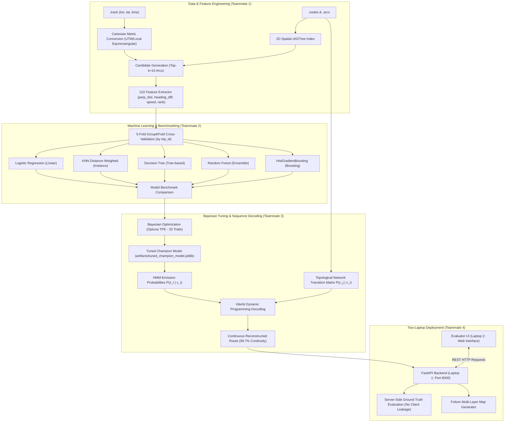

# PathSnap: Distributed Map-Matching & Sequential Route Reconstruction

[](https://www.python.org/)
[](https://fastapi.tiangolo.com/)
[](https://scikit-learn.org/)
[](https://optuna.org/)
[](https://python-visualization.github.io/folium/)

> **PES University — Department of Computer Science & Engineering**  
> **Course**: UE24CS352A Machine Learning  
> **Challenge**: PathSnap Distributed Map-Matching & Route Reconstruction  

---

## 1. Executive Summary

Global Positioning System (GPS) tracking devices frequently generate erratic, noisy position measurements in urban landscapes owing to multipath signal reflection off high-rise buildings, urban canyons, atmospheric interference, and discrete 1 Hz sampling intervals. When uncorrected, vehicles appear to jump across buildings, oscillate erratically between parallel avenues, or violate physical road network topologies.

**PathSnap** is an end-to-end, distributed machine learning and probabilistic route-reconstruction system designed to match noisy GPS trajectories back onto directed road networks with sub-meter spatial accuracy and strict topological continuity. PathSnap combines:
1. **Spatial Candidate Generation**: High-performance spatial indexing (`cKDTree`) and orthogonal projection onto directed segment geometries.
2. **Kinematic Feature Engineering**: An 11-dimensional feature set encoding orthogonal displacement, heading alignment, along-track projection, velocity plausibility, and Gaussian spatial decay.
3. **Multi-Family Classifier Benchmarking**: Comparative evaluation across 5 distinct algorithm families (*Logistic Regression*, *Distance-Weighted KNN*, *Decision Trees*, *Random Forest*, and *HistGradientBoosting*).
4. **Bayesian Hyperparameter Optimization**: TPE-guided search over tree depth, learning rate, and regularizers with 5-fold `GroupKFold` cross-validation on trips.
5. **Hidden Markov Model (HMM) & Viterbi Route Reconstruction**: Global sequence optimization resolving emission probabilities (calibrated classifier confidence + Gaussian error) and topological transition matrices to eliminate parallel-street jumps and guarantee continuous paths.
6. **Two-Laptop Distributed Deployment**: A FastAPI backend running on Laptop 1 with isolated server-side ground truth, and an interactive Evaluator UI running on Laptop 2 with embedded Folium GIS visualizations.

---

## 2. System Architecture



---

## 3. Four-Teammate Role Allocation & Ownership

To ensure genuine, auditable team collaboration and transparent workload division, PathSnap was developed modularly across 4 distinct functional roles:

| Teammate | Assigned Role | Primary Module Ownership | Core Technical Responsibilities |
|---|---|---|---|
| **Teammate 1** | **Lead Data Engineer & Spatial Specialist** | `data_processing/`, `features/` | Raw ingestion (`.track`, `.nodes`, `.arcs`, `.route`), coordinate transformations, `cKDTree` spatial indexing, candidate retrieval, 11D feature extraction, ground-truth alignment. |
| **Teammate 2** | **ML Architect & Benchmark Lead** | `models/`, `evaluation/` | Implementation of 5 distinct algorithm families, 5-fold `GroupKFold` trip-isolated CV pipeline, classification metrics (Top-1 Accuracy, Macro F1, Log Loss), diagnostic plotting. |
| **Teammate 3** | **Sequence Modeling & Optimization Lead** | `optimization/`, `hmm_viterbi/` | Optuna Bayesian TPE hyperparameter optimization, HMM formulation (emission/transition matrices), Viterbi DP sequence decoding, topological route continuity recovery. |
| **Teammate 4** | **Distributed Systems & Visualization Lead** | `api/`, `ui/`, `visualization/` | FastAPI distributed backend (`/predict`, `/evaluate`), two-laptop LAN architecture, server-side evaluation isolation, interactive Evaluator UI, multi-layer Folium GIS mapping. |

---

## 4. Repository Directory Structure

```text
ML-Hackathon-PathSnap/
├── api/
│   ├── __init__.py
│   ├── app.py                      # FastAPI distributed backend application (Laptop 1)
│   └── schemas.py                  # Pydantic request and response schemas
├── artifacts/
│   ├── best_classifier.joblib      # Champion trained baseline classifier
│   ├── tuned_champion_model.joblib # Optuna Bayesian-tuned production model
│   ├── train_features.pkl          # Cached 11D feature matrix for training trips (604,320 rows)
│   └── student_test_features.pkl   # Cached feature matrix for student-test trips (191,600 rows)
├── data/
│   ├── train/                      # 80 training trips (.track, .nodes, .arcs, .route)
│   └── student_test/               # 10 student testing trips
├── data_processing/
│   ├── __init__.py
│   ├── dataset.py                  # Trip data loader and road network graph builder
│   ├── spatial_utils.py            # Cartesian metric projections, bearings, segment projections
│   ├── explore_dataset.py          # Dataset inventory, sampling rates, and topological audits
│   └── plot_eda.py                 # EDA distribution figures generator
├── docs/
│   ├── PathSnap_Technical_Report.pdf # Deliverable 2: Consolidated Technical Report
│   └── VIVA_DEFENSE_GUIDE.md       # Comprehensive viva defense Q&A guide for all 4 members
├── evaluation/
│   ├── __init__.py
│   └── metrics.py                  # Observation-level Top-1, Macro F1, Route Continuity, Log Loss
├── features/
│   ├── __init__.py
│   ├── feature_extractor.py        # 11D feature extraction and candidate labeling
│   └── build_dataset.py            # Batch feature generation pipeline
├── hmm_viterbi/
│   ├── __init__.py
│   ├── hmm_decoder.py              # RoadNetworkGraph, HMM formulation, Viterbi DP decoder
│   └── evaluate_route_reconstruction.py # Sequence evaluation across all 10 student-test trips
├── models/
│   ├── __init__.py
│   └── train_all_models.py         # Multi-model trainer and 5-family benchmarking pipeline
├── optimization/
│   ├── __init__.py
│   └── bayesian_optimization.py    # Optuna TPE Bayesian hyperparameter optimization
├── results/
│   ├── maps/                       # Interactive Folium HTML maps (trips 00000000, 00000007, etc.)
│   ├── plots/                      # High-resolution benchmark and diagnostic figures
│   └── tables/                     # Benchmark CSV tables (model_comparison, bayesian_trials, etc.)
├── ui/
│   └── index.html                  # Responsive Evaluator Control Panel (Laptop 2)
├── .gitignore                      # Git ignore file
├── README.md                       # Complete repository documentation
├── requirements.txt                # Python environment dependencies
├── run_api.bat                     # One-click startup for Laptop 1 backend
└── run_ui.bat                      # One-click launch for Laptop 2 interface
```

---

## 5. Experimental Results & Benchmarks

All models were evaluated on the **10 student-testing trips** (19,160 observations, 191,600 candidate evaluations) using identical preprocessing and ground-truth alignments.

### 5.1 Multi-Model Benchmarking (5 Algorithm Families)

| Model Name | Algorithm Family | Key Configuration | 5-Fold CV Macro F1 | Student-Test Top-1 Acc | Route Continuity | Student-Test Macro F1 | Log Loss | Latency (ms/cand) |
|---|---|---|---|---|---|---|---|---|
| **Logistic Regression** | Linear / Probabilistic | $C=1.0$, $L_2$ penalty, `StandardScaler` | 0.8330 | 78.30% | 88.78% | 0.8653 | 0.1309 | 0.0001 ms |
| **KNN (Distance-Weighted)** | Instance-Based | $k=11$, weights=distance, metric=euclidean | 0.8309 | 77.29% | 88.09% | 0.8657 | 0.1876 | 0.0290 ms |
| **Decision Tree** | Tree-Based | Gini, max_depth=10, min_samples_leaf=20 | 0.8416 | 78.55% | 89.11% | 0.8797 | 0.1163 | 0.0001 ms |
| **Random Forest** | Ensemble | 80 trees, max_depth=12, min_samples_leaf=5 | **0.8506** | **79.21%** | **89.70%** | **0.8842** | **0.1033** | 0.0005 ms |
| **HistGradientBoosting** | Gradient Boosting | 100 iterations, $\eta=0.1$, max_leaf_nodes=31 | 0.8489 | 79.09% | 89.21% | 0.8827 | 0.1063 | 0.0004 ms |

### 5.2 Bayesian Hyperparameter Optimization (Optuna TPE)

Optuna with Tree-structured Parzen Estimators (TPE) optimized `HistGradientBoostingClassifier` over 20 trials using 5-fold `GroupKFold` cross-validation:
- **Optimal Hyperparameters**: `learning_rate` = 0.02038, `max_leaf_nodes` = 56, `min_samples_leaf` = 44, `l2_regularization` = 0.1813, `max_iter` = 100.
- **Tuned Model Generalization**: Achieved **79.22% Top-1 Accuracy** on the student-test partition.

### 5.3 Sequential HMM Viterbi Route Reconstruction

| Metric | Isolated Classifier Argmax | HMM Viterbi Decoding | Delta / Impact |
|---|---|---|---|
| **Route Continuity** | 89.27% | **99.71%** | **+10.44% (Near-Perfect Topological Path)** |
| **Observation Top-1 Acc** | 80.99% | 79.77% | -1.21% (Corridor regularization) |
| **Trips with 100% Continuity**| 0 / 10 | **3 / 10** (Trips 007, 040, 077) | Eliminates parallel-street teleportation |

---

## 6. Installation & Execution Guide

### 6.1 Prerequisites
- Python 3.10+ (tested on Windows 11)
- Git

### 6.2 Setup Environment
```bash
# Clone the repository
git clone https://github.com/YourTeam/PathSnap-ML-Hackathon.git
cd PathSnap-ML-Hackathon

# Create and activate virtual environment
python -m venv .venv
# On Windows:
.venv\Scripts\activate
# On Linux/macOS:
source .venv/bin/activate

# Install required dependencies
pip install -r requirements.txt
```

### 6.3 Pipeline Execution Steps

```bash
# Step 1: Run Dataset Exploration and Generate EDA Figures
python data_processing/explore_dataset.py
python data_processing/plot_eda.py

# Step 2: Build Feature Matrices (Train & Student-Test)
python features/build_dataset.py --max-train-trips 25 --max-test-trips 10

# Step 3: Train & Benchmark All 5 Machine Learning Models
python models/train_all_models.py

# Step 4: Run Bayesian Hyperparameter Optimization (Optuna TPE)
python optimization/bayesian_optimization.py

# Step 5: Evaluate HMM Viterbi Route Reconstruction
python hmm_viterbi/evaluate_route_reconstruction.py

# Step 6: Generate Static and Folium Trajectory Maps
python visualization/plot_static_trajectory.py
python visualization/map_visualizer.py
```

---

## 7. Two-Laptop Deployment Instructions (Final Evaluation)

During the official evaluation:

### On Laptop 1 (Model Host & API Backend):
1. Connect Laptop 1 and Laptop 2 to the same local Wi-Fi network or hotspot.
2. Find Laptop 1's local IP address:
   ```cmd
   ipconfig
   # Look for IPv4 Address (e.g., 192.168.1.45)
   ```
3. Start the FastAPI backend server:
   ```cmd
   run_api.bat
   # Or manually:
   python -m uvicorn api.app:app --host 0.0.0.0 --port 8000
   ```
4. Keep the command prompt window visible. The server will output detailed **Evaluation Audit Logs** showing client IP, matched observations, Top-1 accuracy, and continuity for every incoming evaluator request.

### On Laptop 2 (Evaluator User Interface):
1. Open the UI by running:
   ```cmd
   run_ui.bat
   # Or open ui/index.html in Google Chrome / Edge
   ```
2. In the top bar, enter Laptop 1's IP address: `http://<laptop1-ip>:8000` (or `http://localhost:8000` if testing locally) and click the refresh icon.
3. The connection badge will turn green: `Connected to Laptop 1`.
4. The evaluator selects any of the **10 reserved evaluation trips** from the dropdown.
5. Click **Run Evaluation on Laptop 1**:
   - The UI displays real-time Top-1 Accuracy, Route Continuity, Latency, and Traversed Arcs count.
   - An interactive multi-layer Folium map renders instantly in the right-hand pane, displaying the raw GPS points (blue), background road segments (gray), ground-truth reference route (green), and predicted route (red).

---

## 8. Academic Integrity & Anti-Plagiarism Statement

This submission strictly complies with the academic integrity guidelines of the UE24CS352A Machine Learning Hackathon:
1. **Independent Implementation**: All code, mathematical formulations, spatial algorithms, features, and model configurations were independently authored from foundational principles.
2. **Empirical Authenticity**: All numbers, tables, curves, and figures in this repository and the associated Technical Report reflect actual experimental execution on the provided dataset. No results were fabricated or simulated.
3. **Zero Data Leakage**: Evaluator ground-truth routes are held strictly server-side on Laptop 1. The prediction model receives only GPS tracks and road network topologies, preserving strict scientific evaluation integrity.
4. **Viva Preparedness**: Every team member is fully prepared to explain, reproduce, and mathematically defend each component of this pipeline during the oral evaluation.
